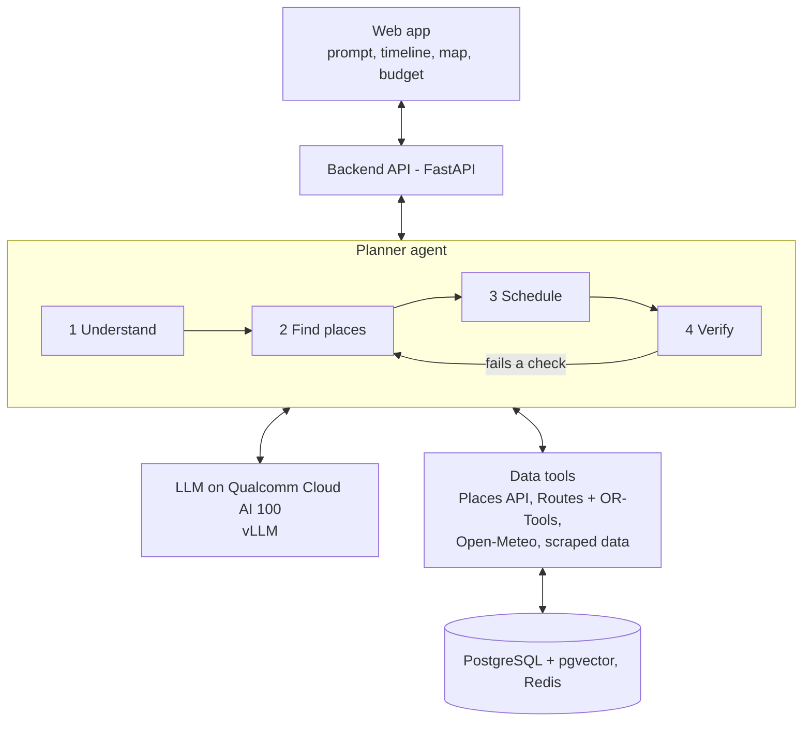

# Prompt-to-Plan Travel Planner: Feature Architecture

Oct 13, 2026 · @aayush

## Overview

The user types one sentence about their trip. The system turns it into a checked, day-by-day plan with a map. The AI model runs on Qualcomm Cloud AI 100. Real facts (places, hours, prices, weather) come from outside data sources, not from the model's memory.

The system has six parts:

1. **Web app (frontend):** where the user types the prompt and sees the plan, map, and budget.
2. **Backend API:** receives requests and sends back the finished plan.
3. **Planner agent (orchestrator):** the "brain" that breaks the trip into steps and calls the tools it needs.
4. **LLM on AI 100:** reads the prompt, picks places, and writes the plan text.
5. **Data tools:** live sources for places, routes, weather, and prices, plus our own scraped data.
6. **Verifier:** checks every place and fact before the user sees it.

The key idea: the LLM plans, the tools supply the facts, and the verifier checks the result.

## System diagram

A request flows down from the web app to the planner. The planner calls the LLM for language work and the data tools for facts. Any stop that fails verification loops back to be fixed.

## Core features (1–5)

These five make up the MVP. Together they turn a prompt into a plan the user can see, change, and afford.

| # | Feature | What the user gets | How it works |
| --- | --- | --- | --- |
| 1 | Prompt to itinerary | Types one sentence, gets a full day-by-day plan. | The LLM pulls out the trip details (city, dates, budget, interests) as JSON. The planner then fetches real places and fills each day. Guided decoding on AI 100 forces clean JSON every time. |
| 2 | Visual itinerary | A timeline, a map with pins, and a photo for each stop. | The backend returns the plan as JSON. The frontend draws it with a map library (for example Leaflet or Mapbox). Photos and coordinates come from the places data, not the LLM. |
| 3 | Personalized picks | Places that fit their interests, budget, and pace. | Each place gets a score: interest match + rating + price fit + distance. Places are stored with embeddings so "street food" also finds "night market." The top scores go into the plan. |
| 4 | Edit by chat | Says "make day 2 more relaxed" and only that part changes. | The plan is saved as JSON. The LLM turns the request into a small edit (swap, remove, add, move). The planner applies it and re-checks only the affected day. |
| 5 | Budget tracker | A running cost total, with a warning if over budget. | Each item carries a cost estimate (price level, ticket price, or scraped average). A simple calculator sums it by category. If the total is too high, the planner swaps in cheaper options. |

Why this split matters: the LLM never invents a place or a price. It only reads the request and arranges facts the tools already gave it.

## Smart planning features (6–10)

These make the plan realistic. Most of this work is done by normal code, not the LLM, so it is fast and reliable.

| # | Feature | What the user gets | How it works |
| --- | --- | --- | --- |
| 6 | Smart routing | Stops in an order that cuts travel time. | Get travel times between all stops (a time matrix) from a routing service such as OSRM or Google Routes. Then solve the best order with Google OR-Tools. |
| 7 | Opening hours and timing check | No visits to closed places; best time to go. | Opening hours come from the places API. They become "time windows" in OR-Tools, which only allows visits inside those windows. |
| 8 | Weather-aware plans | Indoor options on rainy or very hot days. | Pull the daily forecast from Open-Meteo (free, no key, up to 16 days ahead). Each place is tagged indoor or outdoor. Bad-weather days swap outdoor stops for indoor ones. |
| 9 | Backup options | One ready alternative for each stop. | When scoring places, keep the runner-up nearby place of the same type. Store it with the stop. If the main one fails a check, the backup moves in. |
| 10 | Group trips | One plan that fits several people. | Each person gives interests and a budget. Scores are averaged, and the budget uses the lowest one. The planner makes sure each person gets at least one top pick per day. |

Features 6 and 7 work as one step: the solver gets the travel times and the time windows together.

## Trust and accuracy features (11–13)

These stop the AI from making things up. This is the data collection and verification layer.

| # | Feature | What the user gets | How it works |
| --- | --- | --- | --- |
| 11 | Real, verified data | Places, hours, and prices that are real and current. | Two sources: live APIs (places, weather, routes) and our own scraped data (Scrapling and Selenium) from travel and attraction sites. Scraped data is cleaned, given a date, and stored. Old data is refreshed on a schedule. |
| 12 | Hallucination checks | Every stop is confirmed to exist and be open. | After the LLM writes the plan, a verifier checks each stop: Does the place ID exist? Do the name and address match? Is it open at that time? Is the cost in range? Any failure goes back to the planner to fix or swap with the backup. |
| 13 | Source links | A link under each stop showing where the info came from. | Every fact keeps its source URL and the date it was fetched. The frontend shows the link. Facts with no source are not shown. |

Rule for the team: if a fact has no source, it does not reach the user. This also gives us a number to report: the share of stops that pass verification.

## Tech stack

This is the tech stack I'm planning to go with. It's mostly Python, with free or low-cost data sources where possible.

| Layer | Tool | Why |
| --- | --- | --- |
| Frontend | React + Leaflet or Mapbox | Timeline, map pins, budget view |
| Backend API | Python FastAPI | Simple, fast, fits the team's Python skills |
| Planner agent | Python (LangGraph or plain function calls) | Runs the steps: understand, search, route, verify |
| LLM serving | vLLM on Qualcomm Cloud AI 100 | Qualcomm ships vLLM containers with OpenAI-style APIs, plus guided decoding and tool-call parsing ([Qualcomm docs](https://docs.qualcomm.com/bundle/publicresource/80-99100-3/topics/features.md)) |
| Places data | Google Places API (New) or OpenStreetMap | Gives opening hours and price level ([Google docs](https://developers.google.com/maps/documentation/places/web-service/data-fields)) |
| Routing | OSRM or Google Routes + OR-Tools | Travel times, then best order with time windows ([OR-Tools guide](https://developers.google.com/optimization/routing/vrptw)) |
| Weather | Open-Meteo | Free for non-commercial use, no API key ([Open-Meteo](https://github.com/open-meteo/open-meteo)) |
| Scraped data | Scrapling + Selenium | Prices, tickets, and details the APIs miss |
| Storage | PostgreSQL + pgvector, Redis cache | Places, plans, embeddings; cache saves API calls |
